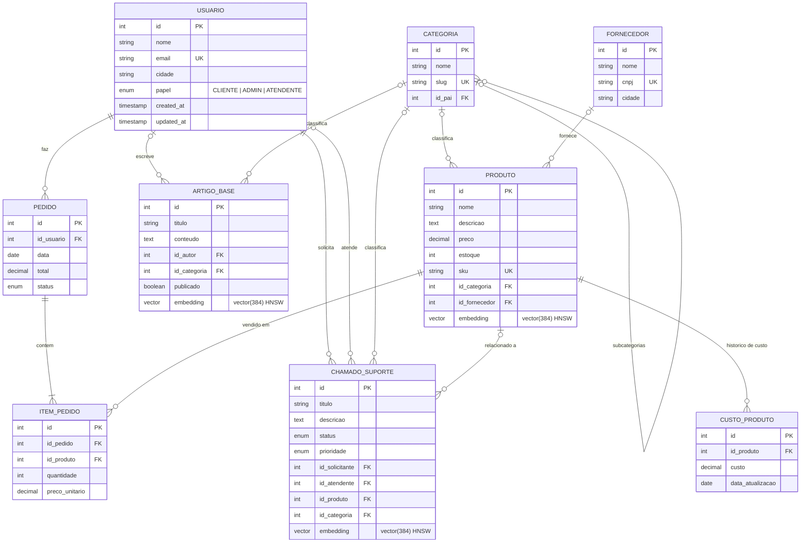

# Smart-Base — Loja de Eletrônicos + Helpdesk com Busca Semântica

Trabalho de **Banco de Dados II (UNIFACVEST)**. A loja de eletrônicos em Java (API REST + painel administrativo + GUI Swing) agora usa **PostgreSQL 16 + pgvector** em Docker, com camada Node.js (Prisma ORM) para modelagem, seed de dados, busca semântica e RAG.

- **Trilha A — Prisma ORM:** schema normalizado (3FN), migrations, transações.
- **Trilha C — RAG / pgvector:** embeddings locais (`Xenova/all-MiniLM-L6-v2`, 384 dimensões), índice HNSW e busca por similaridade de cosseno.

```
loja-bd/
├── docker-compose.yml     # PostgreSQL 16 (pgvector) + pgAdmin
├── .env.example           # modelo de variáveis (o .env real NÃO vai para o git)
├── pom.xml                # projeto Java (Maven)
├── src/main/java/...      # aplicação Java (DAOs em JDBC -> PostgreSQL)
├── frontend/              # loja (index.html) e painel admin (admin.html)
└── smart-base/            # camada Node.js (Prisma + pgvector + RAG)
    ├── prisma/schema.prisma e migrations/
    └── src/               # seed, embeddings, busca, rag, comparar, transação, migração legado
```

## 1. Pré-requisitos

| Ferramenta | Versão | Verificar |
|---|---|---|
| Docker Desktop (com Compose v2) | recente | `docker --version` e `docker compose version` |
| Node.js | **22 a 24** (testado também no 20) | `node -v` |
| JDK | 17 ou superior | `java -version` |
| Maven | 3.9+ | `mvn -v` |

> Na primeira execução do `gerar-embeddings` o modelo (~25 MB) é baixado do Hugging Face, então é preciso internet.

## 2. Passo a passo

```bash
# 1) Variáveis de ambiente (na raiz do projeto)
cp .env.example .env            # PowerShell: Copy-Item .env.example .env

# 2) Sobe PostgreSQL (pgvector) e pgAdmin
docker-compose up -d            # ou: docker compose up -d
docker-compose ps               # postgres deve estar "healthy"

# 3) Dependências Node
cd smart-base
npm install

# 4) Cria as tabelas (migrations: init + pgvector) e gera o Prisma Client
npx prisma migrate dev

# 5) Popula o banco (idempotente: limpa e recria tudo; ~5 s)
node src/seed.js

# 6) Gera os embeddings localmente (~10 a 15 min em CPU para ~9.000 textos)
node src/gerar-embeddings.js
```

Serviços:

| Serviço | Endereço | Credenciais (padrão do `.env.example`) |
|---|---|---|
| PostgreSQL | `localhost:5433` | `smartbase` / `smartbase_dev_123`, banco `smartbase` |
| pgAdmin | http://localhost:5050 | `admin@example.com` / `admin123` |

**pgAdmin → registrar servidor:** *Add New Server* → Host `postgres` (nome do serviço na rede do Docker), Port `5432` (porta interna), usuário e senha do `.env`.

> A porta do host é **5433** (e não 5432) para não conflitar com um PostgreSQL já instalado no Windows. Pode ser alterada em `POSTGRES_PORT` (lembre de ajustar `DATABASE_URL` e `DB_URL`).

## 3. Exemplos de busca (RAG / pgvector)

```bash
cd smart-base

# Busca semântica (top 5 entre chamados, artigos e produtos, com similaridade)
node src/busca-semantica.js "minha tela não liga"
node src/busca-semantica.js "esqueci meu acesso"

# Palavra-chave exata (ILIKE) x semântica, com tempos
node src/comparar-buscas.js
node src/comparar-buscas.js "senha esquecida"

# RAG: recupera trechos e monta o prompt final (LLM externo desativado por padrão)
node src/rag.js "Meu carregador não carrega a bateria, o que devo fazer?"

# Transação: Pedido + ItemPedido + baixa de estoque, com rollback
node src/transacao-exemplo.js
```

Atalhos `npm run`: `migrate`, `seed`, `embeddings`, `busca -- "texto"`, `rag -- "texto"`, `comparar`, `transacao`, `migrar-legado`.

Para ativar a geração da resposta por um LLM (opcional), adicione ao `.env`: `RAG_LLM_ENABLED=true`, `LLM_API_URL`, `LLM_API_KEY` e `LLM_MODEL` (qualquer API compatível com o formato OpenAI).

## 4. Aplicação Java

A conexão é lida das variáveis `DB_URL`, `DB_USER` e `DB_PASSWORD` (ambiente ou arquivo `.env` da raiz). Com o Docker de pé:

```bash
# na raiz do projeto
mvn compile
mvn exec:java        # API + loja + painel admin (classe com.loja.main.ApiMain)
```

- Loja: http://localhost:7000/index.html
- Painel administrativo: http://localhost:7000/admin.html
- GUI Swing (opcional): `mvn exec:java -Dexec.mainClass=com.loja.main.Main`

Mapeamento Java ⇄ novo schema (as telas e a API REST continuam com os mesmos campos):

| Entidade Java | Tabela PostgreSQL | Observação |
|---|---|---|
| `Cliente` | `usuario` (`papel = 'CLIENTE'`) | `dataCadastro` = `created_at` |
| `Fornecedor` | `fornecedor` | — |
| `Produto` | `produto` | SKU gerado automaticamente; `idFornecedor = 0` grava NULL |
| `CustoProduto` | `custo_produto` | — |
| `Pedido` (`idCliente`) | `pedido` (`id_usuario`) | — |
| `ItemPedido` | `item_pedido` | — |

### Migração dos dados do banco legado (MySQL `exercicio_sql`)

O MySQL antigo não faz parte do repositório. Para levar os dados existentes: exporte cada tabela para CSV com cabeçalho (`cliente`, `fornecedor`, `produto`, `custo_produto`, `pedido`, `item_pedido`) em `smart-base/legado/` e rode **antes do seed** (o seed apaga tudo):

```bash
cd smart-base
node src/migrar-legado.js              # lê ./legado
node src/migrar-legado.js legado-exemplo   # exemplo incluído no repositório
```

Os IDs originais são preservados e as sequences são reajustadas. Se preferir recriar do zero, basta rodar o seed.

## 5. Diagrama ER



Regras de `onDelete`: itens de pedido e custos são removidos junto com o pedido/produto (`Cascade`); pedidos com itens impedem apagar usuário/produto (`Restrict`); categoria, fornecedor, atendente, autor e produto relacionado viram `NULL` (`SetNull`); chamado é removido se o solicitante for apagado (`Cascade`).

## 6. Solução de problemas

| Sintoma | Causa provável / solução |
|---|---|
| `P1000: Authentication failed` no Prisma/Node mesmo com a senha certa | Outro PostgreSQL (ex.: serviço do Windows) ocupa a porta. Confira com `netstat -ano \| findstr :5432`. Use a porta `5433` do `.env.example`. |
| `docker: permission denied ... docker_engine` | Docker Desktop fechado ou usuário fora do grupo `docker-users`. Abra o Docker Desktop e tente novamente. |
| `docker-compose: command not found` | Use `docker compose` (Compose v2, sem hífen). |
| `Environment variable not found: DATABASE_URL` | Falta o `.env` na **raiz** do repositório (`cp .env.example .env`). |
| Prisma pergunta o nome de uma nova migration / reclama de *drift* | O banco foi alterado fora do Prisma. Em desenvolvimento: `npx prisma migrate reset --force` e rode o seed de novo. |
| `type "vector" does not exist` | A imagem não é a `pgvector/pgvector:pg16` ou a migration `add_pgvector_embeddings` não foi aplicada. |
| `gerar-embeddings` falha ao baixar o modelo | Sem internet/proxy bloqueando o Hugging Face. O modelo fica em cache em `smart-base/.cache`. |
| Aviso `Unsupported engine` no `npm install` | Node fora de 22–24 (o projeto roda no 20, mas o alvo é 22–24). |
| Java: `Connection refused` ou `password authentication failed` | Containers parados ou `DB_URL/DB_USER/DB_PASSWORD` diferentes do `.env`. Rode a aplicação **na raiz** do projeto (é onde o `.env` é lido). |
| Java: `Address already in use: 7000` | Outra instância da API está rodando. Encerre-a. |
| Recomeçar do zero | `docker-compose down -v && docker-compose up -d`, depois `npx prisma migrate dev`, seed e embeddings. |

